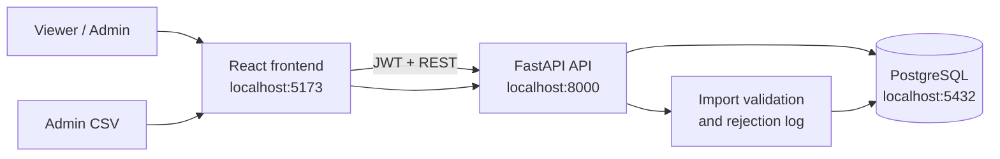
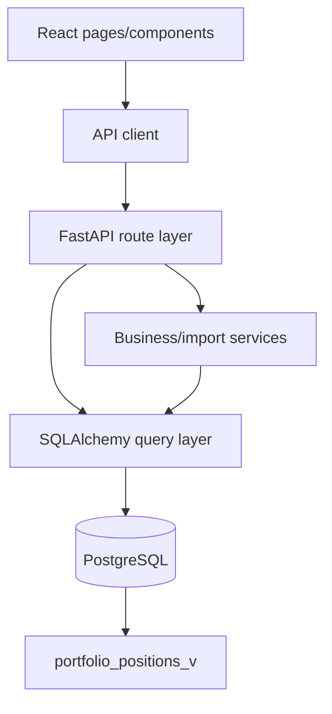
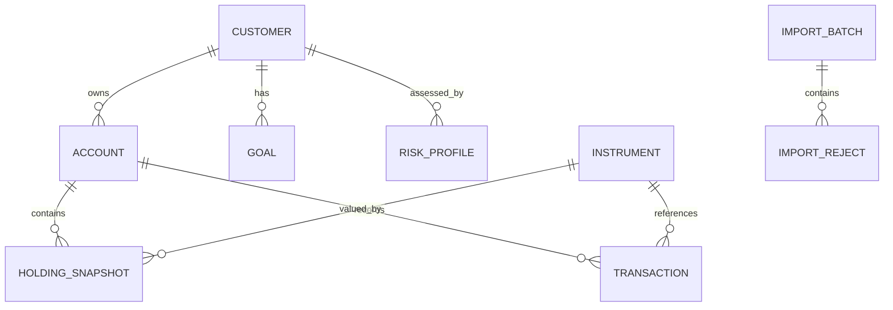
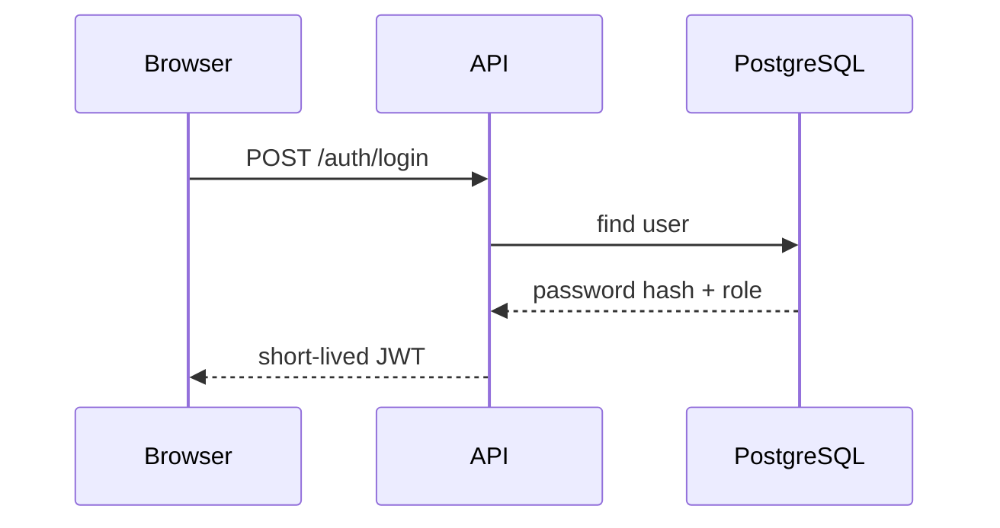
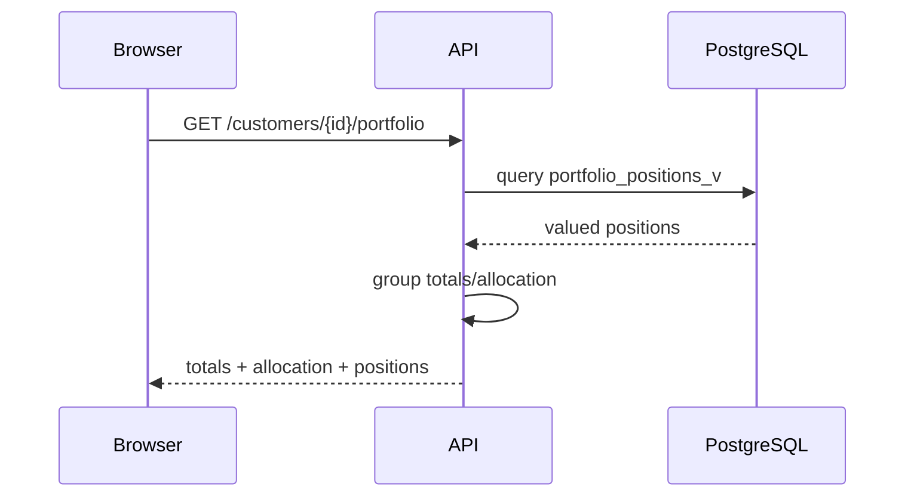
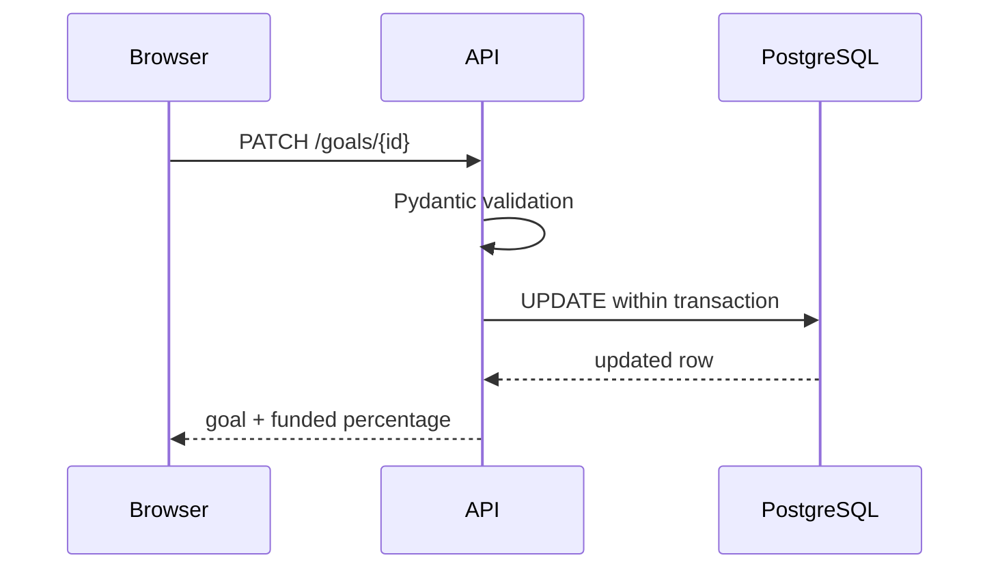
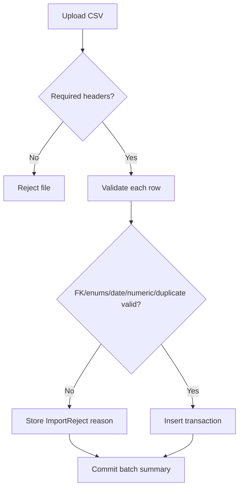
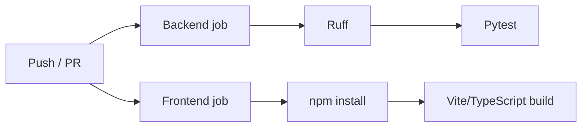

# FinPilot Architecture Report

## 1. Executive overview

FinPilot is an internal read-heavy wealth-operations dashboard. The application consolidates customer identity, accounts, investment holdings, transactions, risk profiles and financial goals. The implementation prioritises database integrity, traceable imports and a small set of understandable service boundaries over unnecessary distributed-system complexity.

Chosen stack: React/TypeScript/Vite for the browser, FastAPI/SQLAlchemy for the API, PostgreSQL for persistence, Alembic for migrations and Docker Compose for reproducible local startup.

## 2. System context

No external market-data or identity provider is required for the synthetic assessment.

## 3. Component architecture

Frontend pages are separated by user task: login, customer search, customer overview, transactions and admin import. Backend routes own HTTP contracts while import rules live in a separate service so they can be unit tested without HTTP.

## 4. ERD / data model

Key integrity controls include primary keys on source identifiers, foreign keys, transaction/goal enumeration checks, non-negative numeric checks and a unique holding key on `(account_id, instrument_id, snapshot_date)`.

## 5. API design

The API is versioned under `/api/v1`. Protected routes require a bearer token. ADMIN-only routes use role-based dependency checks.

Read endpoints use backend filtering and pagination. Error responses use HTTP status codes and concise `detail` messages. FastAPI publishes OpenAPI automatically at `/docs`.

## 6. Key workflows

### Login

### Customer portfolio read

### Goal update

### CSV import

### CI

## 7. Deployment topology

Docker Compose runs three services: PostgreSQL, FastAPI and the React/Vite frontend. The API waits for PostgreSQL health, applies migrations, seeds the synthetic dataset and then starts Uvicorn.

Production mapping would replace local PostgreSQL with a managed HA database, run API/frontend behind a TLS reverse proxy or ingress and move secrets to a secret manager.

## 8. Security

The local assessment uses seeded users and short-lived JWTs. Passwords are hashed. ADMIN operations are authorised server-side. ORM/parameterised SQL protects normal query paths from SQL injection. CSV writes are validated before insertion. CORS is explicitly configured.

The local browser stores JWTs in sessionStorage for simplicity. A production version should prefer corporate OIDC plus secure HTTP-only SameSite cookies or another server-managed session design. PII must be minimised in logs and source datasets should be encrypted at rest and in transit.

## 9. Reliability and operations

`/health` supports local readiness checks. API requests receive correlation IDs and searchable request logs. Import batches preserve accepted/rejected counts and row-level rejection reasons.

Production PostgreSQL would use connection pooling, automated backups and point-in-time recovery. Migrations would be tested in CI/staging and applied as a controlled deployment step with rollback/forward-fix procedures.

## 10. Trade-offs and roadmap

The design stays deliberately monolithic because the supplied dataset is small and the domain does not justify microservices. Synchronous SQLAlchemy keeps the code easy to explain in a live review. At larger scale the import flow should move to object storage plus a background worker and portfolio reads could add caching/materialised views where measurements justify them.

Deferred items include enterprise SSO, refresh-token/session rotation, frontend component tests, full audit events, central metrics/tracing, rate limiting and automated security scanning.
